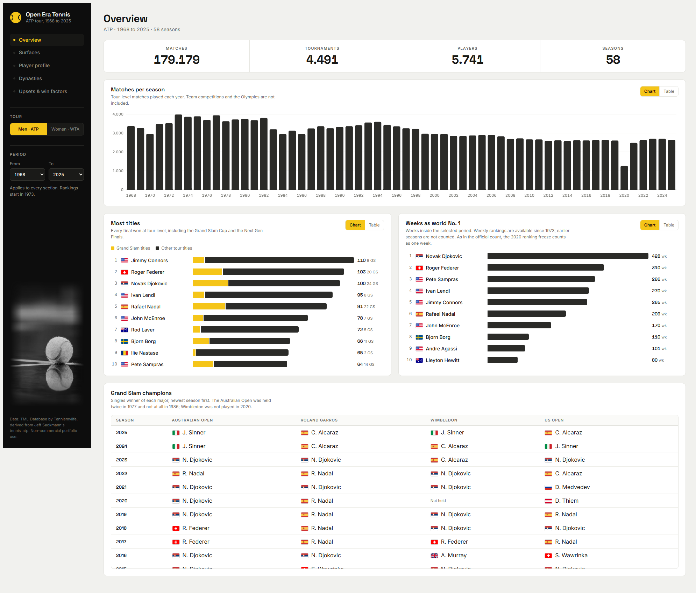
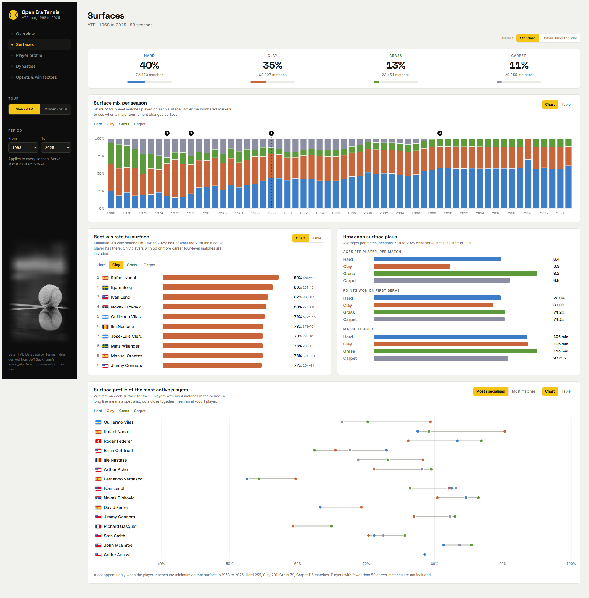
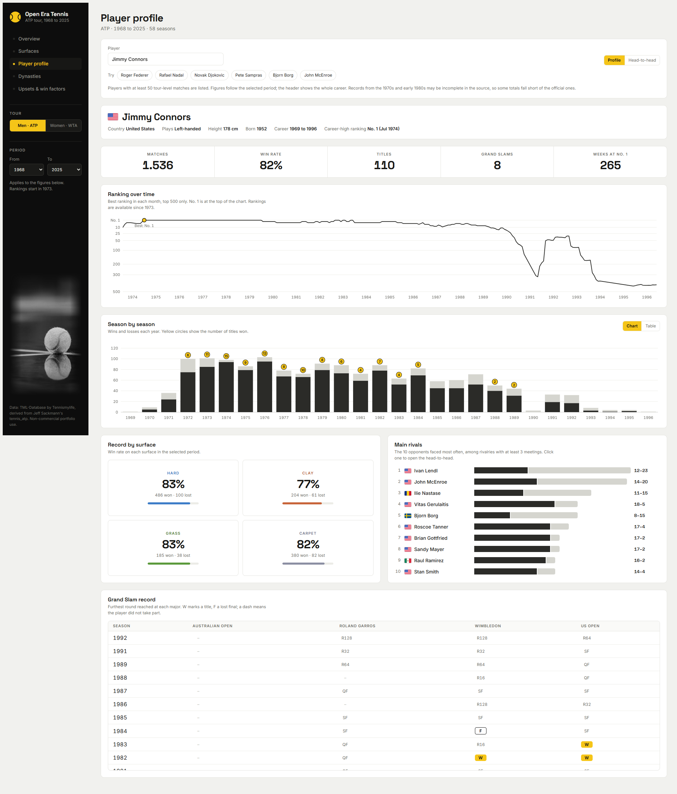
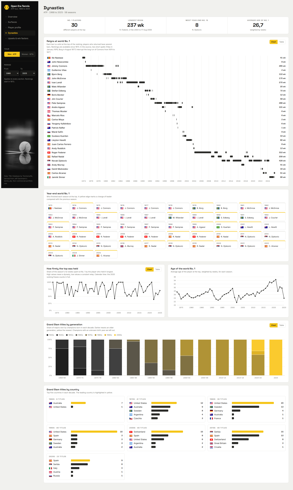
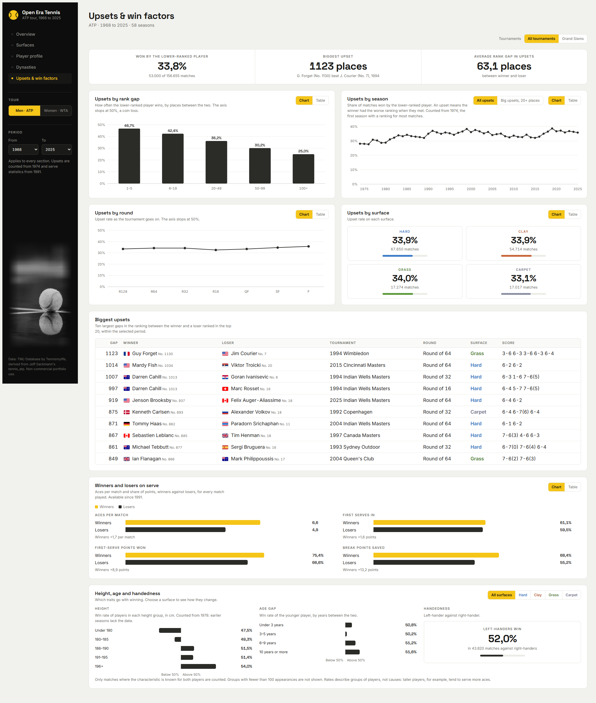
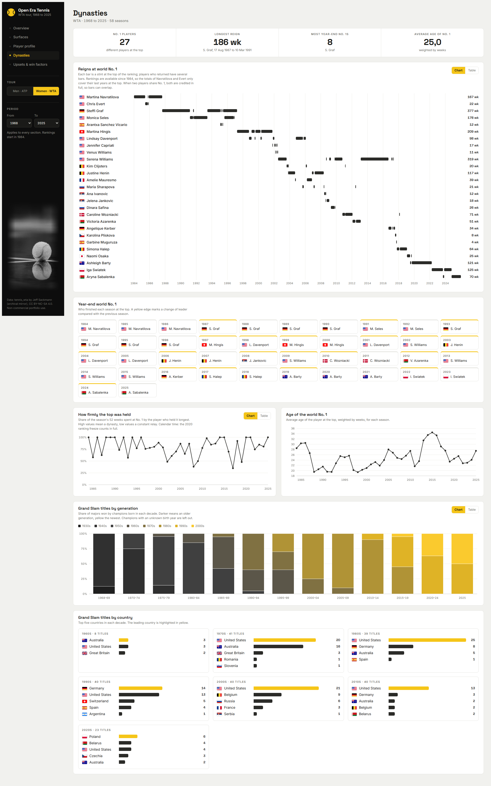

# Tennis Open Era Dashboard

An interactive dashboard on professional tennis from 1968 to 2025, covering both the ATP and WTA tours. It is a single self-contained HTML file: no server, no install, just open it in a browser.

**[Live demo](https://xavipena.com/atp-tennis-dashboard/dashboard/)**



## What you can explore

- **Overview**: matches, tournaments and champions across the Open Era, with a global year filter.
- **Surfaces**: how hard, clay, grass and carpet have shaped results over time.
- **Player profile + H2H**: career summary, ranking history and head-to-head records.
- **Dynasties**: weeks at No. 1, year-end No. 1s and the eras they define.
- **Upsets & win factors**: how often the lower-ranked player wins, the biggest upsets, and what separates winners from losers (serve, height, age, handedness).

Everything can be switched between **Men (ATP)** and **Women (WTA)**. Each chart notes the first season for which the data is reliable.







## Data and attribution

| Tour | Source | Notes |
|---|---|---|
| ATP | [TML-Database](https://github.com/Tennismylife/TML-Database) | Derived from Jeff Sackmann's `tennis_atp` |
| WTA | [Aneeshers/tennis-sackmann-archive](https://huggingface.co/datasets/Aneeshers/tennis-sackmann-archive) on Hugging Face | Archival mirror of Jeff Sackmann's WTA data, whose original repositories are no longer available |

The underlying data was created by **Jeff Sackmann** and is released under
[Creative Commons Attribution-NonCommercial-ShareAlike 4.0](https://creativecommons.org/licenses/by-nc-sa/4.0/) (CC BY-NC-SA 4.0).
This project is a **non-commercial portfolio project** and keeps the same license for the data and the figures derived from it.

Scope: Open Era (1968–2025), main-tour matches only. Davis Cup, Olympics and other team events are excluded.

## Project structure

```
atp-tennis-dashboard/
├── data/
│   ├── raw/          # downloaded source files (not versioned)
│   ├── interim/      # cleaned tables (not versioned)
│   └── processed/    # aggregated tables and dashboard_data.json (not versioned)
├── src/              # the pipeline, one script per step
├── notebooks/        # profiling notebooks (ATP and WTA) documenting the cleaning rules
├── dashboard/
│   ├── template.html # the dashboard (HTML, CSS and JavaScript), versioned
│   └── index.html    # template + embedded data, built by build_dashboard.py
├── docs/images/      # screenshots used in this README
└── requirements.txt
```

## How to run it

Only the code is versioned. Anyone who clones the repository can regenerate the data and the dashboard.

```bash
# 1. Environment
python -m venv .venv
source .venv/bin/activate        # Windows: .venv\Scripts\activate
pip install -r requirements.txt

# 2. Download the raw data
python src/download_data.py      # ATP
python src/download_wta.py       # WTA

# 3. Clean (data/raw -> data/interim)
python src/clean_data.py
python src/clean_players.py
python src/clean_rankings.py
python src/clean_wta_data.py
python src/clean_wta_players.py
python src/clean_wta_rankings.py

# 4. Aggregate (data/interim -> data/processed)
python src/build_processed.py

# 5. Export one JSON with all the dashboard data
python src/export_dashboard_data.py

# 6. Embed the JSON in the template -> dashboard/index.html
python src/build_dashboard.py
```

Then open `dashboard/index.html` in any browser. The notebooks need JupyterLab (included in `requirements.txt`); the scripts do not.

## Data quality notes

The source data is excellent but not perfect. These are the limits that matter when reading the dashboard:

- **Coverage changes over time.** Rankings, serve statistics, height, age and handedness are only shown from the first season in which at least half of the matches have the value, and stay above that threshold for six consecutive seasons. For ATP, rankings start in 1974 and serve statistics in 1991. For WTA they start in 1986 and 2006.
- **WTA early seasons are incomplete**, especially the 1970s and early 1980s. Surface is unknown before 1986, and height and handedness are partial before 1992–1993. Height is also missing for many new players in 2024–2025.
- **Rankings are used as recorded in each match row.** An upset is a match where the winner has the worse ranking. Matches where both players share the same rank are excluded.
- **The list of biggest upsets only includes losers ranked in the top 20.** Otherwise it is dominated by players returning from long absences with rankings above 1.000.
- **Weeks at No. 1 can differ from the official count.** Vilas (January 1976) and Borg (August 1977) appear at No. 1 in the source and split Connors' run (265 weeks here against 268 official). The WTA ranking file starts in 1984, so Navratilova (167 weeks) and Evert (22 weeks) only count from that year; their official totals are 332 and 260, and their year-end No. 1s are undercounted.
- **Each player has a single country**, the last one recorded in the source (Lendl and Navratilova appear as USA, Kodeš as Czechia). Historical codes such as Czechoslovakia, West Germany and Chinese Taipei are shown with their own names; the Soviet Union, Yugoslavia, Serbia and Montenegro, and Rhodesia have no flag and show a three-letter code.
- **Records can be slightly below the official ones**, because Olympics and team events are excluded.
- **Only players with at least 50 matches are listed.** Head-to-head records require at least 3 meetings.
- **Round R256 is shown as R128**, and about 261 pairs of player ids may be duplicates of the same person; they were left untouched.
- **The upset rate rises over the decades in the source.** It may partly reflect how rankings were recorded, so read long-term trends with care.

The cleaning rules are documented step by step in the notebooks.

## Credits and license

- Match data: Jeff Sackmann, via TML-Database (ATP) and the Hugging Face archival mirror (WTA). CC BY-NC-SA 4.0.
- Country flags: [country-flag-icons](https://www.npmjs.com/package/country-flag-icons), MIT license.
- Cover photo: [Todd Trapani](https://www.pexels.com/@todd-trapani-488382/) on [Pexels](https://www.pexels.com/photo/selective-focus-photography-of-tennis-ball-on-floor-2352372/).
- Fonts: Space Grotesk and Inter, via Google Fonts.
- Code: see [LICENSE](LICENSE). The data and anything derived from it remain under CC BY-NC-SA 4.0, for non-commercial use only.

Built by [Xavi Peña](https://xavipena.com) as part of a data analytics portfolio.